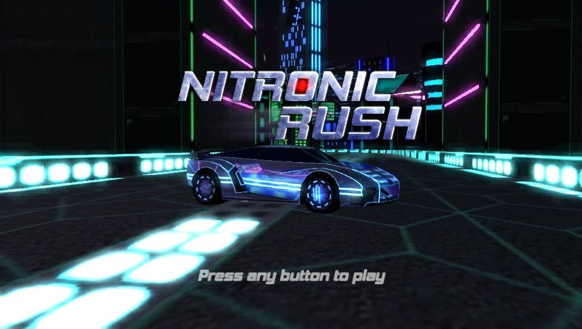
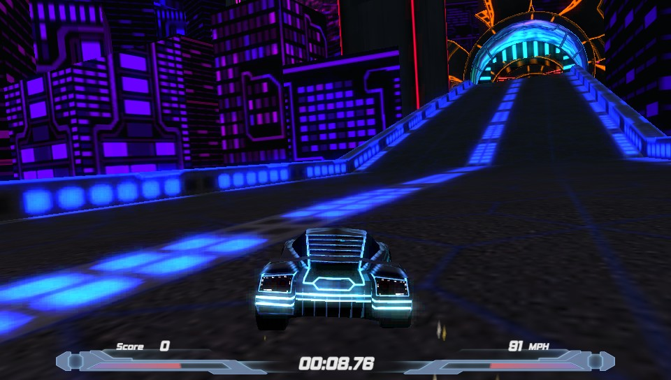
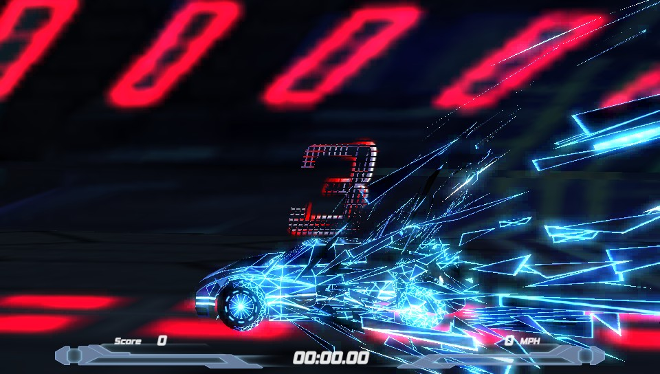
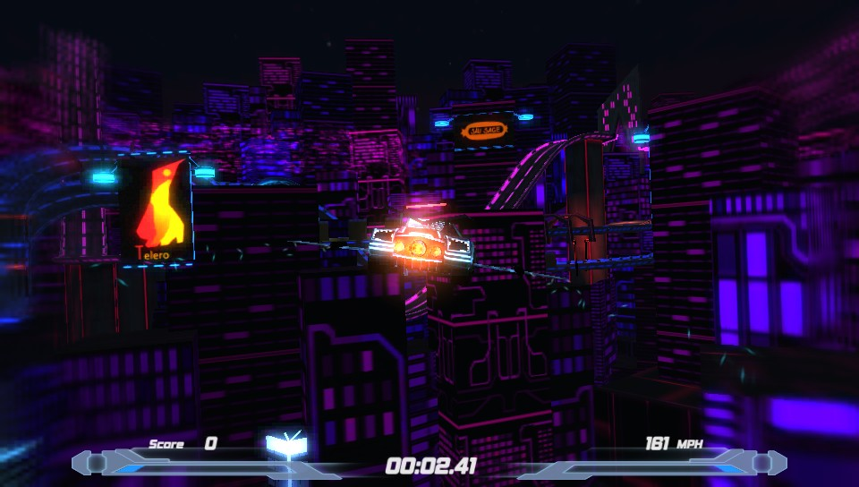

# Nitronic Rush for the PS Vita

A native PS Vita port of [Nitronic Rush](https://games.digipen.edu/games/nitronic-rush) (2011), the free
futuristic racing game made by Team Nitronic, a student team at DigiPen Institute of Technology. The game is
rebuilt in C on VitaSDK and vitaGL: it loads the PC version's own levels, models, textures, sounds and menus, and
its handling, level objects, camera and race rules follow the PC game's code. It is not an emulator.

The repository and the VPK contain no game data. The data is converted on a PC from your own copy of the PC
version, which DigiPen gives away for free, see [Game data](#game-data).

This is an unofficial fan port. It is not affiliated with DigiPen or Team Nitronic.

  
  
  
  

## What works

- Story mode: the tutorial, the six campaign levels with their intro and ending scenes, and the credits drive
- Arcade: Story, Hardcore and Challenge levels, Stunt mode, the old levels and the community levels that come with
  the PC version (52 levels)
- Ghost cars (the developers' runs that come with the game, and your own), local high scores with name entry,
  the 28 achievements and the unlockable cars
- Boosting and overheating, jumping, wings and flight, air tricks and their scores, checkpoints
- The PC version's look: glow and bloom, speed blur, the car materializing at the start and breaking up at the
  finish, tyre tracks, sparks, the wings' light trails, the level objects' animations and lights
- The music with its interactive layers, the announcer and the sound effects, played from the game's own Wwise
  sound bank
- Options (HUD, bloom, motion blur, Advanced Controls, inverted flight, volumes) and button remapping. The menus
  can be used with the touch screen.

It runs at 60 fps. The heaviest parts of Campaign levels 5 and 6 can drop to about 50 fps.

Not included: the PC version's online leaderboards (posting results and the online ghosts).

## Installation

Requirements:

- A PS Vita or PS TV running HENkaku / Ensō
- `libshacccg.suprx` extracted to `ur0:data/`
  ([guide](https://samilops2.gitbook.io/vita-troubleshooting-guide/shader-compiler/extract-libshacccg.suprx))
- Recommended: the [CapUnlocker](https://github.com/GrapheneCt/CapUnlocker) kernel plugin, which lets the game
  load sounds on the Vita's fourth CPU core. Without it the game still runs.
- About 400 MB free on `ux0:`

Steps:

1. Install `NitronicRush-Vita.vpk` from the [releases](../../releases) page (or from VitaDB).
2. Make the game data on a PC as described below and copy the `nitronic` folder it makes to `ux0:data/`, so that
   you have `ux0:data/nitronic/nitronic.idx`.
3. Start the game.

## Game data

1. Download Nitronic Rush for PC from [DigiPen's game gallery](https://games.digipen.edu/games/nitronic-rush)
   (there is also a copy on the [Internet Archive](https://archive.org/details/nitronic-rush)) and install it.
   On Linux or macOS, unpack the installer or the archive copy anywhere instead.
2. Download `NitronicRush-Vita-Converter.zip` from the [releases](../../releases) page and unzip it.
3. Run the converter:
   - **Windows:** drag your Nitronic Rush folder (the one with `NitronicRush.exe` in it) onto
     `CONVERT (Windows).bat`. Python is included in the zip, nothing needs to be installed.
   - **Linux / macOS:** `bash convert.sh "/path/to/Nitronic Rush"`. It needs Python 3 and a C++ compiler (to
     build ww2ogg); it installs numpy and Pillow into a private folder the first time.
4. When it says DONE, copy the `output/nitronic` folder to `ux0:data/` with VitaShell (USB or FTP).

The converter takes about 5 to 30 minutes and needs about 1.5 GB of free space. If it's stopped, running it again
continues where it was. It downloads [wwiser](https://github.com/bnnm/wwiser) (to read the game's Wwise sound
bank) the first time. More details and troubleshooting are in [docs/converter.md](docs/converter.md).

## Controls

| Action | Button |
| --- | --- |
| Gas | R |
| Brake / reverse | L |
| Steer | Left stick |
| Tricks | Right stick, D-Pad |
| Jump | Cross |
| Boost | Circle |
| Wings (in the air) | Square |
| Change view | Triangle |
| Reset to the last checkpoint | Select |
| Pause | Start |

In the air, with the wings folded, the left stick also does tricks (this can be turned off). Every action can be
moved to another button in Controls, and the steering and trick sticks can be swapped. With **Advanced Controls**
(Options), holding L in the air makes the left stick do the tricks and the right stick turns the camera, like the
PC version's advanced scheme.

## Notes

- Saves, settings, high scores and your ghosts are kept in `ux0:data/nitronic/`, along with a log of the last
  session (`boot.log`) and the compiled shader cache.
- The game runs the CPU at 444 MHz, the bus at 222 MHz and the GPU at 222 MHz.
- A few sounds the PC version makes with a Wwise plug-in (the whoosh of passing tunnel arches and checkpoints)
  are recreated, because the plug-in can't be converted.

## Building

See [docs/building.md](docs/building.md). There is also a Linux build of the same code used for automated
testing, described in [docs/testing.md](docs/testing.md). The notes from reverse-engineering the PC version are
in [docs/re](docs/re).

## Credits

- Team Nitronic, who made Nitronic Rush at DigiPen Institute of Technology: Kyle Holdwick, Andy Kibler, Chris
  Barrett, Andrew Nollan, Jason Nollan, Laura Borgen, Eddie Peters, Ariel Gitomer, Nathan Aldrich, Jordan Hemenway
  and M.J. Quigley, with the instructors and thanks listed in the game's credits
- DigiPen Institute of Technology, which publishes the game for free
- Rinnegatamante for vitaGL and vitaShaRK, bythos for SceShaccCgExt, and the VitaSDK team
- hcs for ww2ogg and bnnm for wwiser, which the converter uses for the sound bank
- Sean Barrett (stb_vorbis) and Joergen Ibsen (tinf)
- The LiveArea icon, background art and logo are Nitronic Rush's own

## License

The port's code is released under the GNU GPL v3 (it links vitaGL, which is GPLv3), see [LICENSE](LICENSE). The
bundled libraries keep their own licenses, listed in [THIRD_PARTY.md](THIRD_PARTY.md).

*Nitronic Rush* and all its content are © 2011 DigiPen (USA) Corporation. None of it is included here.
